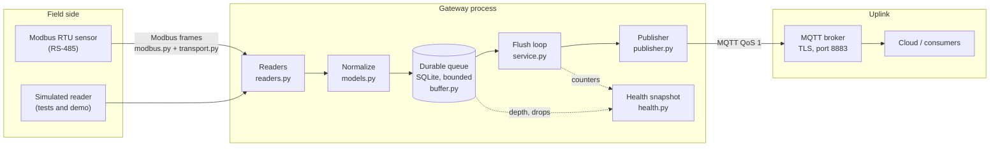
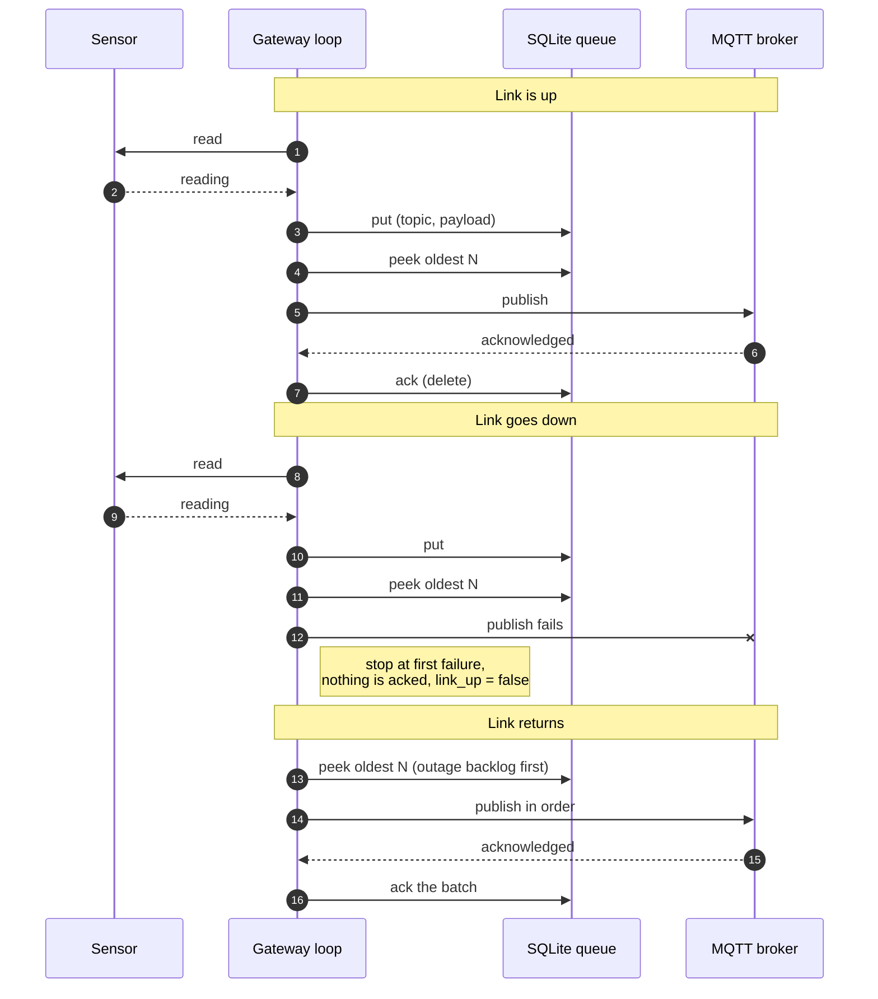
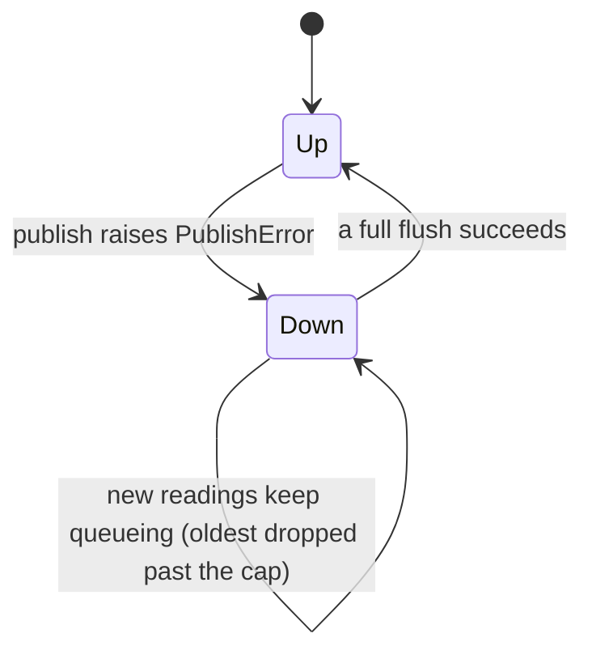

# rpi-edge-gateway

[](https://github.com/sunusr143/rpi-edge-gateway/actions/workflows/ci.yml)

An edge gateway for a Raspberry Pi (or any Linux box) that sits between field devices and the cloud. It reads a Modbus RTU sensor over RS-485, writes every reading to a **durable local queue**, and forwards the queue to an MQTT broker over TLS. If the uplink drops, data waits on disk and is replayed **in order** when the link returns. If the process or the board restarts, the queue survives.

The project exists to show the part of IoT that tutorials skip: what happens when the network is down, a sensor misbehaves, a frame is corrupted, or the device loses power. The logic is written so that all of it can be tested on a laptop with no hardware.

- [Status: what is verified and what is not](#status-what-is-verified-and-what-is-not)
- [Architecture](#architecture)
- [Quick start](#quick-start)
- [How it works](#how-it-works)
- [Modbus RTU primer and worked example](#modbus-rtu-primer-and-worked-example)
- [Message contract](#message-contract)
- [Failure modes and behaviour](#failure-modes-and-behaviour)
- [Configuration](#configuration)
- [Running on a Raspberry Pi](#running-on-a-raspberry-pi)
- [Security](#security)
- [Testing](#testing)
- [Design decisions and trade-offs](#design-decisions-and-trade-offs)
- [Limitations and roadmap](#limitations-and-roadmap)
- [Repository layout](#repository-layout)

---

## Status: what is verified and what is not

This is a personal project. Being precise about its limits matters more than sounding impressive.

| Area | Status |
|---|---|
| Modbus RTU framing: CRC-16, read-holding-registers request, response parsing and error handling | **Unit tested**, including a published CRC test vector (`01 03 00 00 00 0A` gives CRC bytes `C5 CD`) |
| Store-and-forward queue: FIFO order, size cap with drop-oldest, restart survival | **Unit tested** |
| Gateway loop: outage then ordered replay, partial publish failure, failing reader | **Unit tested** with a fake publisher |
| Configuration parsing and validation, serial transport wrapper | **Unit tested** with a fake serial port |
| Simulated end-to-end run (`python -m gateway`) | **Runs** with no hardware and no broker |
| Real RS-485 adapter and a real Modbus device | **Not tested.** The serial code path is exercised only through a fake |
| `MqttPublisher` against a real broker (for example AWS IoT Core or Mosquitto) | **Not tested.** Needs a broker and certificates |
| Running as a systemd service or container on a Raspberry Pi | **Not tested.** The unit file and Dockerfile are a starting point |
| Performance, long soak tests, power-loss behaviour of the SD card | **Not measured** |

28 tests pass on Python 3.9 locally; CI runs them on 3.9 and 3.12 (see [Testing](#testing)). No field or performance results are claimed.

---

## Architecture

### Components



### The key design: buffer first, publish from the buffer

A reading is never sent straight to the network. Every reading goes into the queue first, and the publisher drains the queue. That single rule is what makes outages boring: the sensor side and the network side are decoupled, and the queue absorbs the difference between them.



### Link state



---

## Quick start

Requires Python 3.9 or newer. The core logic and the tests use only the standard library.

```bash
git clone https://github.com/sunusr143/rpi-edge-gateway.git
cd rpi-edge-gateway

python3 -m unittest discover -s tests -t . -v    # 28 tests
python3 -m gateway --cycles 12 --outage 4-8      # simulated run with an uplink outage
```

### What the simulation shows

Two simulated sensors are polled each cycle. One of them fails on cycle 3, and the uplink is down for cycles 4 to 8:

```text
cycle  1 link=up   buffered+2 published= 2 depth= 0
cycle  2 link=up   buffered+2 published= 2 depth= 0
cycle  3 link=up   buffered+1 published= 1 depth= 0     <- one sensor failed, the other still reported
cycle  4 link=DOWN buffered+2 published= 0 depth= 2
cycle  5 link=DOWN buffered+2 published= 0 depth= 4
cycle  6 link=DOWN buffered+2 published= 0 depth= 6
cycle  7 link=DOWN buffered+2 published= 0 depth= 8
cycle  8 link=DOWN buffered+2 published= 0 depth=10     <- 10 messages waiting on disk
cycle  9 link=up   buffered+2 published=12 depth= 0     <- backlog replayed in order, plus the new readings
cycle 10 link=up   buffered+2 published= 2 depth= 0
cycle 11 link=up   buffered+2 published= 2 depth= 0
cycle 12 link=up   buffered+2 published= 2 depth= 0
```

Reading it: during the outage `depth` climbs because nothing can be published. On cycle 9 the link is back and the gateway publishes 12 messages: the 10 queued ones, in their original order, plus that cycle's 2 new readings. Nothing was lost, and the failed sensor read on cycle 3 did not stop the gateway.

---

## How it works

### Module reference

| Module | Responsibility | Key API |
|---|---|---|
| `gateway/modbus.py` | Modbus RTU framing in pure Python | `crc16`, `build_read_holding`, `parse_read_holding`, `to_signed`, `ModbusError` |
| `gateway/transport.py` | Adapts a serial port to a "send a frame, get a frame" function | `make_rtu_transport(ser, response_len)`, `open_serial(port, baud)` |
| `gateway/readers.py` | Turns devices into `Reading` objects | `ModbusTemperatureReader`, `SimulatedReader` |
| `gateway/models.py` | The `Reading` type, normalisation and message encoding | `normalize`, `topic_for`, `payload_for` |
| `gateway/buffer.py` | Durable bounded FIFO queue on SQLite | `Buffer.put`, `peek`, `ack`, `depth`, `dropped_total` |
| `gateway/publisher.py` | Uplink abstraction | `MqttPublisher`, `ListPublisher`, `PublishError` |
| `gateway/service.py` | The loop: poll, buffer, flush, health | `Gateway.poll_once`, `flush`, `run_cycle`, `health` |
| `gateway/health.py` | Host health values | `cpu_temp_c` |
| `gateway/config.py` | Environment-variable configuration with validation | `load_config`, `Config`, `ConfigError` |
| `gateway/run.py` | Production entrypoint with clean shutdown | `python -m gateway.run` |
| `gateway/__main__.py` | The simulated demo | `python -m gateway` |

### The gateway loop

`Gateway.run_cycle()` does two things, always in this order:

1. **`poll_once()`** asks every reader for readings. Each reading is normalised and written to the queue. If a reader raises any exception, the error is counted in `reader_errors` and the loop moves on to the next reader. One bad sensor cannot take the gateway down.
2. **`flush()`** takes up to `batch` messages from the front of the queue and publishes them one by one. Each successful publish is acknowledged (deleted from the queue). At the first `PublishError` it stops, acknowledges only what actually went out, marks the link down, and leaves everything else queued.

Because acknowledgement happens only after a successful publish, a crash between "publish" and "ack" can cause a duplicate on restart but never a loss. This is **at-least-once** delivery, the right default for telemetry. Consumers should tolerate a repeated message (the timestamp in the payload makes de-duplication straightforward).

### The queue

`Buffer` is a table with an auto-incrementing id, which gives a stable insertion order for free.

- **Durable:** it is a SQLite file, so queued data survives a process restart and a reboot (subject to the usual caveats about SD card power loss, see [Limitations](#limitations-and-roadmap)).
- **Bounded:** `max_rows` caps the queue. When a `put` would exceed it, the **oldest** rows are deleted and `dropped_total` is incremented. A long outage can never fill the SD card, and the loss is visible in `health()` rather than silent.
- **Ordered:** `peek` returns rows by id, so replay is oldest first.
- **Thread-safe:** access is guarded by a lock, so a future change to publish from a second thread is safe.

Why drop the oldest rather than the newest? For monitoring data the most recent reading is usually the most valuable. If you prefer the opposite policy, it is a small change in `Buffer.put`.

### Normalisation

Raw register values are not engineering values. `normalize(device_id, metric, raw, scale=..., offset=..., unit=...)` applies the scaling, rounds to 4 decimals, stamps the time if none is given, and **rejects NaN and infinity**, so a broken conversion can never produce a message that poisons downstream consumers.

---

## Modbus RTU primer and worked example

Modbus RTU is a request/response protocol over a serial line, very common on industrial sensors and meters, usually on RS-485. A controller (this gateway) sends a request frame; the addressed device sends one response frame.

A frame is: `address (1 byte) | function (1) | data (n) | CRC-16 (2, low byte first)`.

### Request: read one holding register

Function `0x03` reads holding registers. For slave 1, starting at register 0, count 1:

```text
01  03  00 00  00 01  84 0A
│   │   │      │      └── CRC-16/MODBUS over the preceding 6 bytes, low byte first
│   │   │      └── register count = 1
│   │   └── starting address = 0
│   └── function 0x03: read holding registers
└── slave address 1
```

This is what `build_read_holding(1, 0, 1)` produces.

### Response: a temperature of 25.0 °C

Many temperature sensors report tenths of a degree as a signed 16-bit value. `0x00FA` is 250, so 25.0 °C:

```text
01  03  02  00 FA  38 07
│   │   │   │      └── CRC-16
│   │   │   └── register value 0x00FA = 250
│   │   └── byte count = 2 (one register)
│   └── function echoed
└── slave address
```

`parse_read_holding` verifies, in order: the frame is at least 5 bytes, the CRC matches, the slave address is the one we asked, the function is not an error reply, and the byte count matches the register count requested. Only then does it return `[250]`. `ModbusTemperatureReader` converts that with `to_signed` (so `0xFFCE` becomes -50, i.e. -5.0 °C) and `scale=0.1`.

### Error responses

A device that cannot serve a request sets the top bit of the function code and returns an exception code:

```text
01  83  02  C0 F1        function 0x83 = 0x03 with the error bit set, exception code 2 (illegal data address)
```

This is parsed as a `ModbusError("device exception code 2")`, which the gateway loop counts as a reader error.

### Why the transport is injected

`ModbusTemperatureReader` takes a function `transport(request: bytes) -> bytes`. In production that function wraps a serial port (`make_rtu_transport`); in tests it is a lambda returning a canned frame. That keeps every byte of protocol logic testable without hardware, and it is the reason this repo can claim tested framing while being honest that the physical layer is untested.

---

## Message contract

Each reading becomes one MQTT message.

**Topic:** `gateway/<gateway_id>/<device_id>/<metric>`, for example `gateway/gw-01/boiler-1/temperature`.

**Payload:** compact JSON with sorted keys:

```json
{"src":"rtu-1","ts":1760875200.123,"u":"C","v":25.0}
```

| Field | Meaning |
|---|---|
| `v` | Value after scaling |
| `u` | Unit |
| `ts` | Unix time in seconds when the gateway read it (not when it was published, so replayed data keeps its true timestamp) |
| `src` | Name of the reader that produced it |

The timestamp being the *read* time is deliberate: after an outage, replayed messages arrive late but carry the time they were measured, so charts and alarms downstream stay correct.

---

## Failure modes and behaviour

| What goes wrong | What the gateway does | How you can see it |
|---|---|---|
| Uplink or broker down | Keeps reading, queues to disk, retries every cycle, replays in order on recovery | `buffer_depth` rises, `link_up` is `false` |
| Outage longer than the queue can hold | Drops the **oldest** messages once `BUFFER_MAX_ROWS` is exceeded | `dropped_total` increases |
| Publish fails halfway through a batch | Acknowledges what was sent, keeps the rest | `buffer_depth` stays above zero |
| Sensor times out or returns nothing | Short frame is rejected, counted, loop continues | `reader_errors` increases |
| Corrupted frame on the serial line | CRC mismatch is rejected, counted, loop continues | `reader_errors` increases |
| Device returns a Modbus exception | Rejected with the exception code, counted | `reader_errors` increases |
| One reader raises an unexpected error | Other readers still run in the same cycle | `reader_errors` increases |
| Process killed or board loses power | Queued messages are still in the SQLite file and are sent after restart | Depth is non-zero at startup |
| `SIGTERM` or `SIGINT` | Finishes the current cycle, closes the queue, exits 0 | Clean shutdown |
| Bad configuration | Exits with code 2 and a clear message before touching hardware | Stderr, `systemctl status` |

`Gateway.health()` returns this snapshot (and `gateway.run` logs it as one JSON line every 6 cycles):

```json
{
  "gateway_id": "gw-01",
  "uptime_s": 3600.4,
  "buffer_depth": 0,
  "dropped_total": 0,
  "published_total": 360,
  "reader_errors": 1,
  "link_up": true,
  "cpu_temp_c": 51.2
}
```

---

## Configuration

`python -m gateway.run` is configured entirely through environment variables, which suits systemd (`EnvironmentFile`) and containers. Invalid values fail at startup with exit code 2.

| Variable | Default | Meaning |
|---|---|---|
| `MQTT_HOST` | *(required)* | Broker hostname |
| `MQTT_PORT` | `8883` | Broker port (TLS) |
| `MQTT_CA`, `MQTT_CERT`, `MQTT_KEY` | unset | Paths to the CA certificate, client certificate and private key. Set all three or none |
| `GATEWAY_ID` | `gw-01` | Identifies this gateway; also the MQTT client id and a topic segment |
| `DEVICE_ID` | `sensor-1` | Name of the sensor in topics |
| `MODBUS_PORT` | `/dev/ttyUSB0` | Serial device |
| `MODBUS_BAUD` | `9600` | Baud rate (8N1) |
| `MODBUS_SLAVE` | `1` | Modbus address, 1 to 247 |
| `MODBUS_ADDRESS` | `0` | Register to read |
| `POLL_SECONDS` | `10` | Seconds between cycles |
| `BUFFER_PATH` | `/var/lib/gateway/buffer.db` | SQLite queue file |
| `BUFFER_MAX_ROWS` | `50000` | Queue cap before the oldest messages are dropped |

Example `/etc/gateway/gateway.env`:

```ini
GATEWAY_ID=gw-01
DEVICE_ID=boiler-1
MQTT_HOST=your-broker.example.com
MQTT_CA=/etc/gateway/certs/ca.pem
MQTT_CERT=/etc/gateway/certs/gw-01.crt
MQTT_KEY=/etc/gateway/certs/gw-01.key
MODBUS_PORT=/dev/ttyUSB0
MODBUS_SLAVE=1
MODBUS_ADDRESS=0
POLL_SECONDS=10
```

The current entrypoint reads **one temperature register from one device**. Supporting several devices or other register types means constructing more readers in `gateway/run.py` (see the roadmap).

---

## Running on a Raspberry Pi

> This section describes the intended deployment. It has **not** been run on a Pi; treat it as a starting point and expect to adjust it.

### Hardware

A USB-to-RS-485 adapter on `/dev/ttyUSB0` and a Modbus RTU sensor on the same A/B pair, with correct termination and shared ground. Confirm the sensor's address, baud rate and register map in its datasheet.

### systemd

```bash
sudo useradd --system --home /opt/gateway --groups dialout gateway
sudo mkdir -p /opt/gateway /etc/gateway && sudo chown -R gateway /opt/gateway

sudo -u gateway python3 -m venv /opt/gateway/.venv
sudo -u gateway /opt/gateway/.venv/bin/pip install -r requirements.txt
sudo cp -r gateway /opt/gateway/gateway

sudo cp deploy/gateway.service /etc/systemd/system/
sudo nano /etc/gateway/gateway.env          # see Configuration above
sudo systemctl daemon-reload
sudo systemctl enable --now gateway
journalctl -u gateway -f
```

What the unit file does and why:

| Setting | Reason |
|---|---|
| `Restart=on-failure`, `RestartSec=5` | Recover from crashes without hammering a broken broker |
| `StateDirectory=gateway` | systemd creates `/var/lib/gateway` owned by the service user for the queue |
| `ProtectSystem=strict`, `ReadWritePaths=/var/lib/gateway` | The rest of the filesystem is read-only to the service |
| `NoNewPrivileges`, `PrivateTmp`, `ProtectHome` | Standard least-privilege hardening |
| `DevicePolicy=closed`, `DeviceAllow=/dev/ttyUSB0 rw` | The service can touch only the serial adapter |
| `Group=dialout` | Permission to open the serial port |

### Docker

```bash
docker build -t rpi-edge-gateway .
docker run --rm \
  --device /dev/ttyUSB0 \
  -v gateway-data:/var/lib/gateway \
  -v /etc/gateway/certs:/certs:ro \
  -e MQTT_HOST=your-broker.example.com \
  -e MQTT_CA=/certs/ca.pem -e MQTT_CERT=/certs/gw-01.crt -e MQTT_KEY=/certs/gw-01.key \
  rpi-edge-gateway
```

The queue must live on a volume, otherwise it is lost when the container is replaced.

---

## Security

| Concern | Approach | Remaining work |
|---|---|---|
| Transport security | `MqttPublisher` uses TLS with a CA and client certificate (mutual TLS) | Test against a real broker |
| Device identity | One certificate per gateway, so one compromised gateway can be revoked alone | Certificate provisioning and rotation are not automated |
| Least privilege on the host | Dedicated user, read-only filesystem, closed device policy (see unit file) | Not audited on a real system |
| Secrets in the repo | None. Certificates and keys are referenced by path from the environment file, which is outside the repo | Keep the key file mode `0600` and owned by the service user |
| Untrusted data | Frames are CRC-checked and length-checked before use, values must be finite | Modbus RTU has no authentication; physical access to the bus is trusted |
| Data at rest | The queue is a plain SQLite file | Not encrypted; do not buffer sensitive data without disk encryption |

---

## Testing

```bash
python3 -m unittest discover -s tests -t . -v
```

| File | What it proves |
|---|---|
| `tests/test_modbus.py` | CRC against a published vector; exact request bytes; valid response; bad CRC, exception reply, wrong slave, short frame and byte-count mismatch are all rejected; argument limits |
| `tests/test_buffer_models.py` | FIFO order and ack; drop-oldest cap and counter; survival across a reopen of the database file; invalid size rejected; scaling, topic and payload format; NaN, infinity and empty ids rejected |
| `tests/test_service.py` | Happy path; outage then ordered replay with timestamps still monotonic; partial publish failure keeps unsent rows; a failing reader does not stop the others; Modbus reader end to end; CRC error counted; health snapshot |
| `tests/test_config_transport.py` | Defaults, required host, range and type validation, TLS files must be all-or-nothing; the serial wrapper clears stale input, writes the request and reads the response; a timeout yields a short frame that is rejected |

CI (`.github/workflows/ci.yml`) runs the suite on Python 3.9 and 3.12, runs the simulation, and checks that the entrypoint refuses to start without configuration.

Not covered by tests, because the environment cannot cover them: real serial timing, a real MQTT broker, and SD card behaviour under power loss.

---

## Design decisions and trade-offs

**Buffer first, publish from the buffer.** The alternative is to publish directly and buffer only on failure. That has two code paths and an ordering problem when the link flaps. One path (always queue) is simpler to reason about and to test.

**SQLite instead of a flat file or an in-memory list.** An in-memory list loses data on restart. A flat file needs hand-written locking, truncation and corruption handling. SQLite is in the standard library, transactional, and well understood. The trade-off is write amplification on SD cards, noted under limitations.

**Drop oldest when full.** The queue must be bounded or an outage can fill the disk and take the gateway down with it. For monitoring, fresh data beats stale data, and the drop count makes the loss observable.

**Stop at the first publish failure.** Continuing after a failure would reorder messages and spend time on a link that is down. Stopping keeps order and cheap retries.

**At-least-once delivery.** Exactly-once needs coordination with the broker that is not worth the complexity here. Duplicates after a crash are possible; the read timestamp makes them easy to filter.

**Hardware behind interfaces.** `Reader`, `Publisher` and the transport function are the seams. Everything above them is plain Python that runs on a laptop. The price is that the real implementations of those seams are the untested part, which is stated openly.

**Standard library for the core.** `paho-mqtt` and `pyserial` are only needed on the device and are imported lazily, so the tests and the simulator have no dependencies to install.

---

## Limitations and roadmap

Known limitations:

- One device and one register per process. Real installations have several devices and register maps.
- Only function `0x03` (read holding registers) is implemented. No writes, no input registers or coils.
- No hardware testing yet; the serial timing, inter-frame gaps and RS-485 direction control are unproven here.
- SQLite on an SD card wears the card under constant writes. For production use a high-endurance card, tune `PRAGMA` settings (for example WAL and a relaxed synchronous mode), or batch writes.
- The health snapshot is logged but not published as its own MQTT topic.
- `MqttPublisher` waits up to 5 seconds per message, which is slow for large backlogs; batching would help.

Roadmap, roughly in order of value:

1. Run against a real Modbus device and a real broker, and record what breaks.
2. Config file with multiple devices, register maps and scaling.
3. Publish the health snapshot as a retained MQTT topic so the cloud can alarm on a silent gateway.
4. Add BLE readers (for example with `bleak`).
5. Batch publishing and SQLite tuning for SD cards.
6. Prometheus metrics endpoint for local scraping.

---

## Repository layout

```text
rpi-edge-gateway/
├── gateway/
│   ├── modbus.py         CRC-16 and Modbus RTU framing
│   ├── transport.py      serial port adapter
│   ├── readers.py        Modbus and simulated readers
│   ├── models.py         Reading, normalisation, topic and payload encoding
│   ├── buffer.py         durable bounded SQLite queue
│   ├── publisher.py      MQTT publisher and in-memory test publisher
│   ├── service.py        the gateway loop
│   ├── health.py         host health values
│   ├── config.py         environment configuration
│   ├── run.py            production entrypoint
│   └── __main__.py       simulated demo
├── tests/                28 unit tests, standard library only
├── deploy/gateway.service  hardened systemd unit
├── Dockerfile
├── requirements.txt      paho-mqtt and pyserial, device only
└── .github/workflows/ci.yml
```
